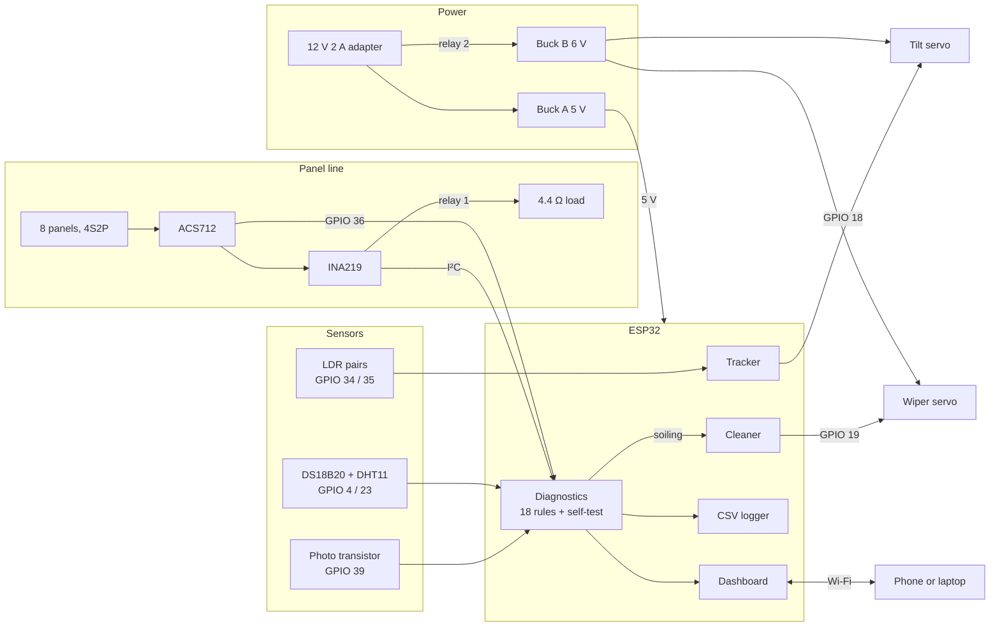
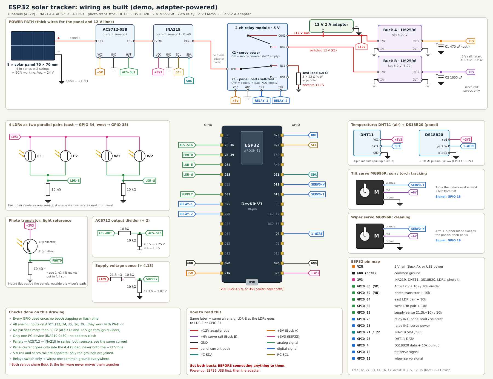

# Solar Tracker ESP32

**A low-cost smart solar panel prototype that follows the sun (or a torch), cleans itself, measures its own output with two cross-checked current sensors and tells you when something is wrong. Everything runs on a single ESP32.**


---

## Contents

- [Features](#features)
- [How it works](#how-it-works)
- [Hardware](#hardware)
- [Wiring](#wiring)
- [Getting started](#getting-started)
- [Dashboard and API](#dashboard-and-api)
- [Fault diagnostics](#fault-diagnostics)
- [Configuration](#configuration)
- [Experiments and analysis](#experiments-and-analysis)
- [Project structure](#project-structure)
- [Roadmap](#roadmap)
- [Safety](#safety)
- [License](#license)

## Features

| Module | What it does | Hardware |
|---|---|---|
| **Solar tracking** | Single-axis tracking. Two LDR pairs on opposite edges of the panel board; the tilt servo turns towards the brighter pair until both match. Follows a torch in real time in demo mode. | 4 LDR modules, MG996R tilt servo |
| **Self-cleaning** | A foam flap on a rod along the panel's centre line sweeps the left row, then the right row, and parks straight up. On demand, or automatically when dust is confirmed. | MG996R wiper servo |
| **Power monitoring** | Panel voltage, current and power from two independent current sensors in series. | INA219, ACS712 |
| **Light-referenced dust check** | Compares panel current with a photo-transistor light reference, so clouds and shade don't look like dust. | Photo transistor |
| **Fault diagnostics** | 18 rule-based checks: sensor disagreement, missing sensors, disconnected panel or load, covered LDRs, unresponsive tilt, overheating, supply voltage, soiling. A relay self-test checks both current sensors against zero and a known load. | 2-channel relay, 4.4 Ω load |
| **Temperatures** | Panel temperature (back of a panel) and air temperature and humidity (in the shade). | DS18B20, DHT11 |
| **Wireless dashboard** | Live readings, faults and controls at `http://solar-tracker.local`. Falls back to its own Wi-Fi hotspot. | ESP32 Wi-Fi |
| **Experiment logging** | One CSV line per second over Serial, with experiment labels and event marks, ready for `analysis/analyze.py`. | USB |

**Design rule:** one ESP32, a DIY frame, low-cost sensors and simple rules. No expensive mechanical assemblies and no second microcontroller until the core prototype works.

### Try it before building

Two interactive pages live in [`docs/interactive/`](docs/interactive). Download them and open them in any browser (or publish them with GitHub Pages, see below):

- **[`3d-model.html`](docs/interactive/3d-model.html)**: an orbitable 3D model of the rig. Play a full day and night, add dust, change the battery charge and inject faults. The tracker, wiper, battery, sleep and diagnostics all respond.
- **[`wiring-sheet.html`](docs/interactive/wiring-sheet.html)**: the schematic plus a numbered wire list you can tick off at the bench.

To get live links: **Settings → Pages → Deploy from a branch → main / (root)**. The pages then open at `https://<your-username>.github.io/solar-tracker-esp32/docs/interactive/3d-model.html`.

## How it works



### Control loop

| Task | Demo | Normal | Logic |
|---|---|---|---|
| Tracking | 50 ms | 1 min | `imbalance = (A − B) / (A + B)`. Outside ±0.05 → step 1° (2° in demo when far off) towards the brighter pair; limit ±60°. |
| Power, dust ratios, faults, CSV | 1 s | 1 s | Read INA219, ACS712 and photo transistor; compute Rule A and Rule B; evaluate faults; print one CSV line. |
| Dust confirmation / auto-clean | 5 s | 5 min | Rule B below 0.80 on 3 checks in a row → `SOILING`; with auto-clean on, run the wiper (at most every 1 min / 2 h). |
| Temperatures | 5 s | 2 min | DS18B20 (non-blocking) and DHT11. |
| Wiper | 15 ms per degree | same | Left row → up → right row → up, 2 passes. Tracking pauses meanwhile. |
| Self-test | on command | daily | Panels disconnected: both sensors ≈ 0 A, ACS712 re-zeroed, Voc measured. Then on the load: sensors agree, V ≈ I·R. |

Everything is non-blocking, so the dashboard stays responsive while the panel moves or the wiper runs.

## Hardware

| Component | Qty |
|---|---|
| ESP32 DevKit V1 (30-pin, WROOM) | 1 |
| Solar panels 70 × 70 mm, wired 4 in series × 2 strings | 8 |
| INA219 current/voltage sensor | 1 |
| ACS712-05B current sensor | 1 |
| LDR modules (VCC / GND / AO) | 4 |
| Photo transistor | 1 |
| DS18B20 waterproof probe | 1 |
| DHT11 module | 1 |
| MG996R servos (tilt and wiper) | 2 |
| 2-channel 5 V relay module | 1 |
| LM2596 buck converters (5.0 V and 6.0 V) | 2 |
| 12 V 2 A adapter | 1 |
| 22 Ω resistors (5 in parallel = 4.4 Ω load) | 5 |
| Resistors for dividers (10 k, 21.3 k), capacitor 1000 µF, wires, frame | — |

The earlier battery design (v0.2) is in [`docs/bom.md`](docs/bom.md) and [`docs/wiring.md`](docs/wiring.md).

## Wiring



The diagram shows the **current build, set up for the demo**: a 12 V 2 A adapter powers everything, and the panels drive a 4.4 Ω test load through both current sensors. Firmware v0.5 matches this diagram; the text in `docs/wiring.md` still describes the earlier battery version.

| ESP32 pin | Connects to |
|---|---|
| VIN | 5 V rail (Buck A), or USB power (never both) |
| GND | Common ground = adapter − |
| 3V3 | INA219, DHT11, DS18B20, LDRs, photo transistor |
| GPIO 4 | DS18B20 data + 10 kΩ pull-up to 3V3 |
| GPIO 18 | Tilt servo signal |
| GPIO 19 | Wiper servo signal |
| GPIO 21 / 22 | INA219 SDA / SCL |
| GPIO 23 | DHT11 data |
| GPIO 25 | Relay IN1: panels → test load, or disconnected for the self-test |
| GPIO 26 | Relay IN2: 12 V to Buck B (servo power) |
| GPIO 33 | Supply voltage sense (21.3 kΩ + 10 kΩ from +12 V, 10 kΩ to GND) |
| GPIO 34 / 35 | East / west LDR pairs (10 kΩ to GND) |
| GPIO 36 (VP) | ACS712 output through a 10 kΩ / 10 kΩ divider |
| GPIO 39 (VN) | Photo transistor (10 kΩ to GND) |

The panels (8 × 70 × 70 mm, 4 in series × 2 strings) feed ACS712 → INA219 → relay 1 → test load. Buck A (5.00 V) powers the ESP32, relay module and ACS712; Buck B (6.0 V) powers only the two MG996R servos, through relay 2.

Complete 46-wire list, energy budget and troubleshooting: [`docs/wiring.md`](docs/wiring.md).

## Getting started

### 1. Clone

```bash
git clone https://github.com/sumanbhatbtech25-beep/Self-SOLAR-TrackingandCleaning.git
cd Self-SOLAR-TrackingandCleaning
```

### 2. Install the libraries

| Library | Author | Used for |
|---|---|---|
| ESP32Servo | Kevin Harrington (madhephaestus) | Both servos |
| Adafruit INA219 | Adafruit | Current sensor 1 (pulls in Adafruit BusIO) |
| OneWire | Paul Stoffregen | DS18B20 bus |
| DallasTemperature | Miles Burton | DS18B20 readings |
| DHT sensor library + Adafruit Unified Sensor | Adafruit | DHT11 |

PlatformIO installs these from `platformio.ini`. In the Arduino IDE, install them from **Library Manager**.

### 3. Calibrate your rig

Upload [`tests/calibration`](tests/calibration/calibration.ino), open the Serial Monitor (115200, Newline) and:

1. Type `t<angle>` until the panels lie flat → `TILT_FLAT_DEG`.
2. Type `w<angle>` to find the wiper's straight-up park, left-row and right-row angles → `WIPER_PARK_DEG`, `WIPER_LEFT_DEG`, `WIPER_RIGHT_DEG`.
3. Shine a torch on one LDR pair. If its reading goes **down**, keep `LDR_LIGHT_LOWERS_READING = true`. Set `LDR_DARK_LEVEL` to about half the room-light light level.

Put the numbers in [`config.h`](firmware/solar_tracker/config.h).

### 4. Wi-Fi and ThingSpeak

```bash
cp firmware/solar_tracker/secrets.example.h firmware/solar_tracker/secrets.h
```

Edit `secrets.h` with your network (2.4 GHz), and optionally your ThingSpeak Channel ID, Write/Read API keys and TalkBack ID/key. The board uploads to ThingSpeak every 20 s in demo mode (2 min normally) and checks TalkBack for phone commands (`CLEAN`, `AUTOCLEAN_ON`, `AUTOCLEAN_OFF`, `SELF_TEST`, `CALIBRATE`, `TRACK_AUTO`, `PARK_FLAT`). Channel fields: 1 power (W), 2 current (mA), 3 light (mV), 4 cleanliness (%), 5 tilt (°), 6 panel temp (°C), 7 air temp (°C), 8 humidity (%); status = active faults. Without it the board starts its own hotspot, **SolarTracker-Setup** (password `solar1234`), and the dashboard is at `http://192.168.4.1`.

### 5. Build and flash

**Arduino IDE 2.x:** install **esp32 by Espressif Systems**, open `firmware/solar_tracker/solar_tracker.ino`, select **ESP32 Dev Module**, Upload, Serial Monitor at **115200 baud** with **Newline**.

**PlatformIO:** `pio run -t upload` then `pio device monitor`.

Power-up order: ESP32 on USB first, then the 12 V adapter. Never connect USB and the 5 V VIN wire at the same time unless your board has a USB protection diode.

### 6. First run

1. Type `help` in the Serial Monitor.
2. Clean the panels, give them steady light and type `calibrate`.
3. Type `selftest`: relay 1 clicks, and the result shows on the dashboard.
4. Shine a torch from one side: the panel should turn towards it. If it turns away, set `TRACK_INVERT = true`.
5. Type `clean` to run the wiper.

## Dashboard and API

Open **`http://solar-tracker.local`** (or the IP printed on Serial). It refreshes every second and works offline.

| Method | Endpoint | Description |
|---|---|---|
| `GET` | `/` | Dashboard page |
| `GET` | `/api/status` | All readings, tracker state, soiling ratios, self-test result and active faults as JSON |
| `POST` | `/api/cmd?c=<command>` | Run any Serial command, e.g. `c=clean`, `c=calibrate`, `c=mode%20fixed%200`, `c=label%20E2_light_s1` |

```bash
curl http://solar-tracker.local/api/status
curl -X POST "http://solar-tracker.local/api/cmd?c=clean"
```

### Serial commands

| Command | Effect |
|---|---|
| `label <name>` | Tags every following CSV line, e.g. `label E2_light_s1` |
| `mark <event>` | Tags the next CSV line once, e.g. `mark inject_ldr` |
| `clean` | Run one wiper cycle |
| `auto on` / `auto off` | Automatic cleaning when dust is confirmed (off by default) |
| `calibrate` | Store the clean-panel baseline |
| `selftest` | Relay self-test of both current sensors |
| `mode auto` / `mode fixed [deg]` | Tracking on / tilt held (flat by default) |
| `tilt <deg>` | Manual tilt from flat (−60 to 60) |
| `wiper <deg>` | Move the wiper servo (testing) |
| `header` | Print the CSV header again |

## Fault diagnostics

| Code | Triggered when |
|---|---|
| `INA219_MISSING` | INA219 not answering on I²C; the ACS712 takes over |
| `ACS712_FAULT` | ACS712 output out of range at GPIO 36 |
| `CURRENT_SENSOR_MISMATCH` | INA219 and ACS712 differ by more than 0.1 A or 20 % (the light reference decides which to trust) |
| `PANEL_DISCONNECTED` | Light present but panel voltage < 1 V |
| `NO_CURRENT` | Panel voltage present but current < 10 mA |
| `LDR_MISMATCH` | One LDR pair below 15 % of the other |
| `TILT_NO_RESPONSE` | The tilt moved 12° towards the light but the imbalance didn't drop |
| `PANEL_OVERHEAT` | Panel above 60 °C |
| `PANEL_HOT_VS_AIR` | Panel more than 20 °C hotter than the air |
| `TEMP_SENSOR` / `DHT_SENSOR` | DS18B20 / DHT11 not responding |
| `HIGH_HUMIDITY` | Humidity above 90 % |
| `SUPPLY_LOW` / `SUPPLY_HIGH` | 12 V supply below 11 V / above 14 V |
| `SOILING` | Light-referenced ratio below 0.80 on 3 checks in a row |
| `SELF_TEST_FAIL` | Last relay self-test failed |
| `LIGHT_SATURATED` | Photo transistor at its ceiling; dust check paused |
| `NOT_CALIBRATED` | No clean-panel baseline yet |

**Dust check:** after `calibrate`, the firmware stores *k = I / L* (current per mV of light). Each second it logs two ratios: **Rule A** = I / I₀ (current only) and **Rule B** = I / (k·L) (light-referenced). Only Rule B raises `SOILING`, because a cloud lowers both I and L together. Cleaning does **not** re-calibrate automatically, so before/after comparisons stay honest.

## Configuration

Every pin, calibration value, interval and threshold is in [`firmware/solar_tracker/config.h`](firmware/solar_tracker/config.h):

| Setting | Default | Change it when |
|---|---|---|
| `DEMO_MODE` | `true` | `false` for outdoor running with energy-saving intervals |
| `TILT_FLAT_DEG`, `TRACK_INVERT` | `90`, `false` | From the calibration sketch / the panel turns away from the light |
| `WIPER_PARK_DEG`, `WIPER_LEFT_DEG`, `WIPER_RIGHT_DEG` | `90`, `10`, `170` | From the calibration sketch |
| `LDR_LIGHT_LOWERS_READING`, `LDR_DARK_LEVEL` | `true`, `300` | From the calibration sketch |
| `ACS712_DIVIDER`, `SUPPLY_DIVIDER` | `2.0`, `4.13` | You change those resistors |
| `TEST_LOAD_OHMS` | `4.4` | You use a different load |
| `SOILING_RATIO_WARN` | `0.80` | Dust alerts come too early or too late |

| Interval | Demo | Normal |
|---|---|---|
| CSV log + power read | 1 s | 1 s |
| Tracking step | 50 ms | 1 min |
| Temperatures | 5 s | 2 min |
| Dust check | 5 s | 5 min |
| Auto-clean gap | 1 min | 2 h |

## Experiments and analysis

[`experiments/PROTOCOL.md`](experiments/PROTOCOL.md) gives step-by-step instructions for experiments E1–E6: baseline noise, dust levels, cloud test, cleaning, fault injection, and tracking vs fixed. It covers the labels and marks to type, and a notes sheet.

```bash
pip install -r analysis/requirements.txt
python analysis/capture.py --port COM5 data/raw/session1.csv   # log while typing commands
python analysis/analyze.py data/raw                            # results, tables and figures
python analysis/analyze.py --synthetic                         # pipeline test on generated data only
```

`analyze.py` writes `analysis/output/summary.md`, a CSV and LaTeX table per experiment, and four figures (PNG + PDF). The `--synthetic` mode only checks that the pipeline works: its outputs are watermarked and must never be reported as results.

## Project structure

```
├── firmware/solar_tracker/     Main firmware (Arduino sketch folder, PlatformIO src)
│   ├── solar_tracker.ino       Setup and main loop with all timing
│   ├── config.h                Pins, calibration, intervals, thresholds
│   ├── sensors.*               INA219, ACS712, photo transistor, LDRs, DS18B20, DHT11, supply
│   ├── relays.*                Relay 1 (panels / load) and relay 2 (servo power)
│   ├── tracker.*               LDR-pair tracking, fixed/manual modes, tilt response check
│   ├── cleaner.*               Non-blocking wiper sequence
│   ├── diagnostics.*           Dust ratios, sensor cross-check, self-test, fault rules
│   ├── commands.*              Serial / dashboard commands
│   ├── logger.*                1-second CSV log
│   ├── web.*, dashboard_html.h Wi-Fi, dashboard, JSON API
│   └── app_state.*             Shared readings and settings
├── tests/calibration/          Servo angles and raw light readings
├── tests/                      Older single-block test sketches
├── experiments/PROTOCOL.md     How to run E1–E6
├── analysis/                   capture.py, analyze.py, synthetic test data generator
├── docs/                       Wiring, BOM, bring-up, diagnostics, schematic, 3D model
└── platformio.ini
```

## Roadmap

Progress is tracked here and in [`CHANGELOG.md`](CHANGELOG.md).

### Phase 1: Core prototype
- [x] System design and component selection
- [x] 3D model of the rig
- [x] Full wiring schematic and wire list
- [x] Firmware: tracking, cleaning, monitoring, diagnostics, dashboard
- [x] Bring-up test sketches
- [x] Build the DIY frame and mount the panels
- [x] Wire and bring up on the bench
- [x] Firmware v0.5 for the as-built rig, with experiment logging and analysis pipeline
- [ ] Calibrate tilt, wiper and clean baseline (`tests/calibration`)
- [ ] Run experiments E1–E6 ([protocol](experiments/PROTOCOL.md)) and add the results to the paper
- [ ] Add build photos and a demo video

### Phase 2: Battery storage (designed in v0.2; demo runs from an adapter)
- [x] Battery, charge controller and buck converter in the design, wiring and 3D model
- [x] Firmware: battery monitoring, low-battery cut-off, night deep sleep
- [x] Battery-aware diagnostics (full, low, overcharge, no charge)
- [ ] Buy and fit the battery system
- [ ] Measure real day and night energy use and update the energy budget

### Phase 3: Better data
- [ ] Log to SD card or push to a cloud dashboard (ThingSpeak / Blynk / MQTT)
- [ ] Time-of-day aware tracking using NTP time and a sun-position model
- [ ] Battery current sensing with a second INA219 for true state of charge
- [ ] Measured tracked-vs-fixed energy gain report

### Phase 4: Second ESP32 and TinyML (if budget allows)
- [ ] Split control and sensing onto two ESP32s (or ESP32 + ESP32-CAM)
- [ ] Train a TinyML model on logged data to tell soiling, shading and faults apart
- [ ] Camera-based dust detection
- [ ] Water-assisted cleaning with the DC motor pump

## Safety

- **Battery first:** a shorted 12 V battery can deliver over 100 A. Fit fuse F2 within 15 cm of the + terminal, and never let bare battery leads touch.
- Connect the battery to the charge controller before the panel; disconnect the panel first.
- Lead-acid batteries can vent gas when overcharged. Keep the battery ventilated, away from sparks, and watch for `BATTERY_HIGH`.
- The panel output (up to ~22 V, ~0.6 A) is low voltage but enough to heat thin wires. Keep fuse F1 in line.
- Keep the INA219 bus voltage under 26 V. Check your panel's Voc before connecting.
- Servos can pinch fingers. Unplug servo power before adjusting the linkage.
- This is a bench and outdoor test prototype, not weatherproof. Bring the electronics in when it rains.

## License

Released under the [MIT License](LICENSE).

## Acknowledgements

Built with the Arduino core for ESP32 and libraries by Adafruit, Kevin Harrington, Paul Stoffregen and Miles Burton.
