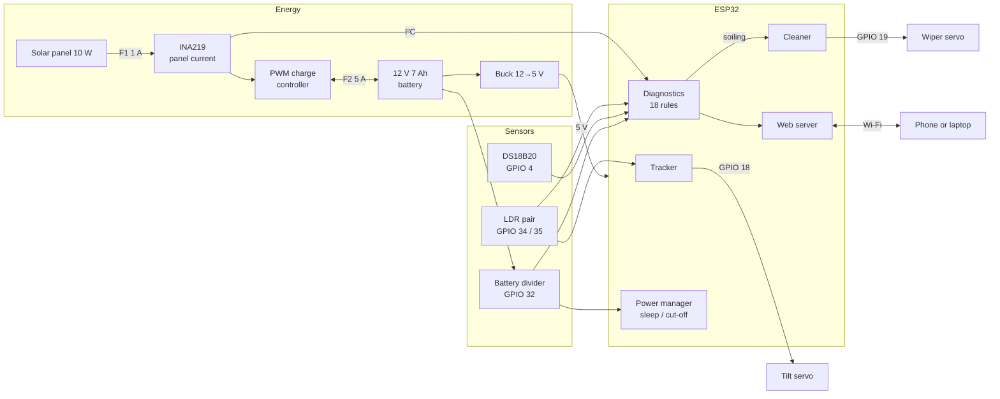

# Solar Tracker ESP32

**A low-cost smart solar panel prototype that follows the sun, cleans itself, stores its energy in a battery, measures its own output and tells you when something is wrong. Everything runs on a single ESP32.**


---

## Contents

- [Features](#features)
- [How it works](#how-it-works)
- [Hardware](#hardware)
- [Wiring](#wiring)
- [Getting started](#getting-started)
- [Dashboard and API](#dashboard-and-api)
- [Fault diagnostics](#fault-diagnostics)
- [Configuration](#configuration)
- [Project structure](#project-structure)
- [Roadmap](#roadmap)
- [Safety](#safety)
- [License](#license)

## Features

| Module | What it does | Hardware |
|---|---|---|
| **Solar tracking** | Single-axis east–west tracking. Two LDRs split by a shade wall; the panel turns toward the brighter side. Parks facing sunrise at night. | 2 × LDR, tilt servo |
| **Self-cleaning** | Servo-driven wiper sweeps the glass on demand, or automatically when soiling is detected. | Wiper servo + rubber blade |
| **Battery storage** | The panel charges a 12 V battery during the day; the battery runs the ESP32 and servos day and night. Low-battery protection and night-time deep sleep stretch the reserve to 2–3 cloudy days. | 12 V 7 Ah SLA, PWM charge controller, buck converter |
| **Power monitoring** | Panel voltage, current and power, battery voltage and panel temperature. | INA219, battery divider, DS18B20 |
| **Fault diagnostics** | 18 rule-based checks: open circuit, no charging, battery low/full/overcharged, overheating, servo stall, covered LDR, soiling and more. | Firmware |
| **Wireless dashboard** | Live readings, power chart, diagnostics and controls at `http://solar-tracker.local`. Falls back to its own Wi-Fi access point. | ESP32 Wi-Fi |
| **Data logging** | One CSV line per second over Serial, ready for analysis and future ML training. | USB |

**Design rule:** one ESP32, a DIY frame, low-cost sensors and simple rules. No expensive mechanical assemblies and no second microcontroller until the core prototype works.

### Try it before building

Two interactive pages live in [`docs/interactive/`](docs/interactive). Download them and open them in any browser (or publish them with GitHub Pages, see below):

- **[`3d-model.html`](docs/interactive/3d-model.html)**: an orbitable 3D model of the rig. Play a full day and night, add dust, change the battery charge and inject faults. The tracker, wiper, battery, sleep and diagnostics all respond.
- **[`wiring-sheet.html`](docs/interactive/wiring-sheet.html)**: the schematic plus a numbered wire list you can tick off at the bench.

To get live links: **Settings → Pages → Deploy from a branch → main / (root)**. The pages then open at `https://<your-username>.github.io/solar-tracker-esp32/docs/interactive/3d-model.html`.

## How it works



### Control loop

| Task | Interval | Logic |
|---|---|---|
| Tracking | 100 ms | `imbalance = (E − W) / (E + W)`. Above +0.04 → step 1° east. Below −0.04 → step 1° west. Otherwise hold. Travel limited to ±60°. |
| Night park | 500 ms | Average LDR below 150 → walk back to the east limit, ready for sunrise. |
| Sensors + diagnostics | 1 s | Read INA219, battery, DS18B20 and LDRs, evaluate all rules, log CSV. |
| Auto-clean | 1 s | `SOILING` active for 1 min and last auto clean > 30 min ago → run the wiper. |
| Wiper cycle | 12 ms steps | Two out-and-back sweeps (~4 s). Tracking pauses while the blade is on the glass. |
| Night sleep | after 5 min parked in the dark | Deep sleep in 15-minute naps; each wake checks the light and sleeps again if still dark. |
| Low-battery cut-off | battery < 11.8 V for 30 s | Deep sleep in 10-minute naps until the battery recovers above 12.3 V. |

Everything is non-blocking, so the dashboard stays responsive while the panel moves or the wiper runs.

### Energy budget

| | Per sunny day |
|---|---|
| Harvest (10 W panel, Bengaluru, after losses) | ≈ 30–40 Wh |
| Daytime use (ESP32 + Wi-Fi + servos, ≈ 1 W × 12 h) | ≈ 12 Wh |
| Night use, asleep (≈ 0.12 W × 12 h) | ≈ 1.5 Wh |
| Usable battery reserve (half of 84 Wh) | ≈ 42 Wh, about 3 days |

## Hardware

| Component | Qty | Target cost |
|---|---|---|
| ESP32 development board (DevKit V1, 30-pin) | 1 | ₹300–450 |
| INA219 power sensor | 1 | ₹90–150 |
| LDRs, resistors and wiring | 2 | ₹50–100 |
| DS18B20 waterproof temperature probe | 1 | ₹100–160 |
| Solar panel, 10 W | 1 | ₹300–500 |
| Servo for panel tilt (MG90S / SG90) | 1 | ₹100–180 |
| Servo for wiper (SG90) | 1 | ₹100–180 |
| DC motor and driver *(optional, not fitted yet)* | 1 | ₹150–250 |
| Breadboard, wires and connectors | — | ₹150–250 |
| DIY frame, rails and wiper blade | — | ₹250–400 |
| Power supply and protection (buck converter, fuse, capacitor, divider) | — | ₹200–350 |
| 12 V 7 Ah sealed lead-acid battery | 1 | ₹700–900 |
| PWM solar charge controller, 10 A | 1 | ₹300–450 |
| Battery fuse (5 A) and thicker wire | — | ₹100–150 |
| Miscellaneous and shipping | — | ₹300–500 |
| **Total (without DC motor)** | | **₹3,040–4,720** |

Full list with buying notes: [`docs/bom.md`](docs/bom.md).

## Wiring


| ESP32 pin | Connects to |
|---|---|
| VIN | 5 V rail (buck converter output) |
| GND | Common ground = battery − |
| 3V3 | INA219, LDR dividers, DS18B20 |
| GPIO 4 | DS18B20 data + 4.7 kΩ pull-up to 3V3 |
| GPIO 18 | Tilt servo signal |
| GPIO 19 | Wiper servo signal |
| GPIO 21 / 22 | INA219 SDA / SCL |
| GPIO 32 | Battery divider (100 kΩ from BAT+, 27 kΩ to GND) |
| GPIO 34 / 35 | East / west LDR dividers (10 kΩ to GND) |

The panel feeds the charge controller through the INA219, and the controller charges the battery. The buck converter is fed straight from the battery, after fuse F2, so the ESP32 has one solid ground whichever controller you buy.

> **Panel − connects only to the controller's PV− terminal, never to ground.** Many cheap controllers switch the negative line, and a ground link would bypass them and overcharge the battery.

Complete 46-wire list, energy budget and troubleshooting: [`docs/wiring.md`](docs/wiring.md).

## Getting started

### 1. Clone

```bash
git clone https://github.com/<your-username>/solar-tracker-esp32.git
cd solar-tracker-esp32
```

### 2. Install the libraries

| Library | Author | Used for |
|---|---|---|
| ESP32Servo | Kevin Harrington (madhephaestus) | Both servos |
| Adafruit INA219 | Adafruit | Power sensor (pulls in Adafruit BusIO) |
| OneWire | Paul Stoffregen | DS18B20 bus |
| DallasTemperature | Miles Burton | DS18B20 readings |

PlatformIO installs these automatically from `platformio.ini`. In the Arduino IDE, install them from **Library Manager**.

### 3. Add your Wi-Fi

```bash
cp firmware/solar_tracker/secrets.example.h firmware/solar_tracker/secrets.h
```

Edit `secrets.h` with your network name and password. It is git-ignored. If you skip this step, the board starts its own access point, **SolarTracker-Setup** (password `solar1234`), and the dashboard is at `http://192.168.4.1`.

### 4. Build and flash

**PlatformIO** (VS Code extension or CLI):

```bash
pio run -t upload
pio device monitor
```

**Arduino IDE 2.x:**

1. Install the **esp32 by Espressif Systems** board package.
2. Open `firmware/solar_tracker/solar_tracker.ino`.
3. Select **ESP32 Dev Module** and your port, then **Upload**.
4. Open the Serial Monitor at **115200 baud**.

> When uploading over USB, unplug the 5 V → VIN wire unless your board has a protection diode on its USB 5 V line.

**No battery yet?** Power the 5 V rail from a 5 V adapter and set `BATTERY_ENABLED = false` in `config.h`. Everything else works the same.

### 5. Bring up and calibrate

Follow [`docs/bring-up.md`](docs/bring-up.md). It tests each block with the sketches in [`tests/`](tests), then calibrates the battery reading, tilt centre and direction, wiper angles and the clean-panel baseline.

## Dashboard and API

Open **`http://solar-tracker.local`** (or the IP printed on Serial). The page refreshes every 2 seconds and works offline, since everything is served by the ESP32.

It shows panel voltage, current and power against expected power, battery voltage and charge, panel temperature, tilt, LDR readings and panel cleanliness. Below those are a 5-minute power chart, the active diagnostics and the event log. Controls cover cleaning, calibration, auto-clean and manual tilt.

With night sleep on (the default), the dashboard goes offline after dark and comes back at sunrise.

| Method | Endpoint | Description |
|---|---|---|
| `GET` | `/` | Dashboard page |
| `GET` | `/api/status` | All readings, battery, tracker state, findings and log as JSON |
| `POST` | `/api/clean` | Start a cleaning cycle (`409` if one is running) |
| `POST` | `/api/autoclean?on=1` | Turn auto-clean on (`on=0` for off) |
| `POST` | `/api/calibrate` | Save the clean-panel baseline (`409` with a reason if conditions aren't right) |
| `POST` | `/api/mode?m=auto` | Tracker mode: `auto` or `manual` |
| `POST` | `/api/tilt?deg=-20` | Set tilt in degrees (−60 east to +60 west); switches to manual |

```bash
curl http://solar-tracker.local/api/status
curl -X POST http://solar-tracker.local/api/clean
```

<details>
<summary>Sample <code>/api/status</code> response</summary>

```json
{
  "uptime_s": 5321,
  "voltage": 13.41, "current": 0.512, "power": 6.87,
  "panel_temp": 41.3,
  "battery_enabled": true, "battery_voltage": 13.16, "battery_percent": 100,
  "battery_full": false, "night_sleep": true,
  "ldr_east": 2810, "ldr_west": 2765, "imbalance": 0.008,
  "tilt": -18, "mode": "auto", "state": "holding",
  "wiper_busy": false, "clean_runs": 3, "auto_clean": true,
  "calibrated": true, "expected_current": 0.538, "expected_power": 7.21,
  "soiling_ratio": 0.95,
  "worst": "ok",
  "findings": [{"code": "OK", "sev": "ok", "msg": "No faults detected."}],
  "log": ["01:28:40  Clean baseline updated", "01:28:30  Cleaning cycle finished"],
  "rssi": -61
}
```
`battery_percent` is a rough estimate from voltage and reads high while charging.
</details>

## Fault diagnostics

| Code | Severity | Triggered when |
|---|---|---|
| `BATTERY_HIGH` | Critical | Battery > 15.0 V (overcharging) |
| `BATTERY_CRITICAL` | Critical | Battery < 11.8 V; low-battery sleep follows |
| `OPEN_CIRCUIT` | Critical | Panel voltage > 19.5 V but current < 10 mA |
| `NO_PANEL_VOLTAGE` | Critical | Bright light but panel voltage < 1 V |
| `OVERHEAT` | Critical | Panel temperature > 60 °C |
| `TILT_STALL` | Critical | Moving for 4 s without the LDR imbalance dropping |
| `INA219_MISSING` | Critical | Power sensor not found at boot |
| `BATTERY_LOW` | Warning | Battery < 12.0 V |
| `BATTERY_SENSOR` | Warning | Battery divider reads < 5 V |
| `NO_CHARGE` | Warning | Bright light, battery not full, but no charging current |
| `SOILING` | Warning | Panel current < 80 % of expected for the current light |
| `LDR_MISMATCH` | Warning | One LDR < 15 % of the other for 10 s in bright light |
| `TEMP_SENSOR` | Warning | DS18B20 not responding |
| `BATTERY_FULL` | Info | Battery ≥ 13.6 V; charging and soiling checks paused |
| `AT_LIMIT` | Info | Sun beyond the ±60° tilt range |
| `NIGHT` | Info | Too dark to track |
| `LDR_SATURATED` | Info | LDRs maxed out; soiling check paused |
| `NOT_CALIBRATED` | Info | No clean-panel baseline saved yet |

How expected current is estimated, sleep behaviour and how to trigger each fault on purpose: [`docs/diagnostics.md`](docs/diagnostics.md).

## Configuration

Every pin, threshold and timing value is in [`firmware/solar_tracker/config.h`](firmware/solar_tracker/config.h). The ones you are most likely to change:

| Setting | Default | Change it when |
|---|---|---|
| `BATTERY_ENABLED` | `true` | Bench testing from a 5 V adapter with no battery |
| `BATTERY_CAL` | `1.00` | The battery reading differs from a multimeter |
| `NIGHT_DEEP_SLEEP` | `true` | You want the dashboard online all night (costs ~10 Wh per night) |
| `BATTERY_CUTOFF_V` / `BATTERY_RESUME_V` | `11.8` / `12.3` | Using a different battery chemistry |
| `TILT_SERVO_CENTER` | `90` | The panel isn't flat at servo 90° |
| `TILT_INVERT` | `false` | The panel turns away from the brighter LDR |
| `TILT_LIMIT_DEG` | `60` | Your frame allows more or less travel |
| `TRACK_DEADBAND` | `0.04` | The panel hunts back and forth (raise) or lags (lower) |
| `WIPER_PARK_DEG` / `WIPER_END_DEG` | `0` / `170` | Matching the blade's real sweep |
| `DIAG_SOILING_RATIO` | `0.80` | Auto-clean fires too often or too late |
| `SERIAL_CSV_LOG` | `true` | You want a quiet Serial Monitor |

## Project structure

```
solar-tracker-esp32/
├── firmware/solar_tracker/     Main firmware (Arduino sketch folder, PlatformIO src)
│   ├── solar_tracker.ino       Setup, main loop, Wi-Fi, auto-clean, sleep, CSV logging
│   ├── config.h                Pins, thresholds, timings
│   ├── secrets.example.h       Wi-Fi template, copy to secrets.h
│   ├── sensors.*               INA219, DS18B20, LDR reading
│   ├── power.*                 Battery voltage, low-battery cut-off, deep sleep
│   ├── tracker.*               LDR-based tilt control and stall detection
│   ├── cleaner.*               Non-blocking wiper cycle
│   ├── diagnostics.*           Rule engine and clean-panel baseline
│   ├── web.*                   HTTP server and JSON API
│   ├── dashboard_html.h        Dashboard page served by the ESP32
│   └── app_state.*             Shared state and event log
├── tests/                      One bring-up sketch per hardware block
├── docs/
│   ├── wiring.md               Pin map, wire list, energy budget, troubleshooting
│   ├── bom.md                  Bill of materials and buying notes
│   ├── bring-up.md             Step-by-step testing and calibration
│   ├── diagnostics.md          Every rule and sleep mode explained
│   ├── images/                 Schematic (add build photos here)
│   └── interactive/            3D model and wiring sheet (open in a browser)
├── platformio.ini
├── CHANGELOG.md
└── LICENSE
```

## Roadmap

Progress is tracked here and in [`CHANGELOG.md`](CHANGELOG.md).

### Phase 1: Core prototype
- [x] System design and component selection
- [x] 3D model of the rig
- [x] Full wiring schematic and wire list
- [x] Firmware: tracking, cleaning, monitoring, diagnostics, dashboard
- [x] Bring-up test sketches
- [ ] Build the DIY frame and mount the panel
- [ ] Wire and bring up on the bench
- [ ] Calibrate tilt, wiper and clean baseline outdoors
- [ ] Log a full day of data and compare tracked vs. fixed output
- [ ] Add build photos and a demo video

### Phase 2: Battery storage (designed in v0.2)
- [x] Battery, charge controller and buck converter in the design, wiring and 3D model
- [x] Firmware: battery monitoring, low-battery cut-off, night deep sleep
- [x] Battery-aware diagnostics (full, low, overcharge, no charge)
- [ ] Buy and fit the battery system
- [ ] Measure real day and night energy use and update the energy budget

### Phase 3: Better data
- [ ] Log to SD card or push to a cloud dashboard (ThingSpeak / Blynk / MQTT)
- [ ] Time-of-day aware tracking using NTP time and a sun-position model
- [ ] Battery current sensing with a second INA219 for true state of charge
- [ ] Measured tracked-vs-fixed energy gain report

### Phase 4: Second ESP32 and TinyML (if budget allows)
- [ ] Split control and sensing onto two ESP32s (or ESP32 + ESP32-CAM)
- [ ] Train a TinyML model on logged data to tell soiling, shading and faults apart
- [ ] Camera-based dust detection
- [ ] Water-assisted cleaning with the DC motor pump

## Safety

- **Battery first:** a shorted 12 V battery can deliver over 100 A. Fit fuse F2 within 15 cm of the + terminal, and never let bare battery leads touch.
- Connect the battery to the charge controller before the panel; disconnect the panel first.
- Lead-acid batteries can vent gas when overcharged. Keep the battery ventilated, away from sparks, and watch for `BATTERY_HIGH`.
- The panel output (up to ~22 V, ~0.6 A) is low voltage but enough to heat thin wires. Keep fuse F1 in line.
- Keep the INA219 bus voltage under 26 V. Check your panel's Voc before connecting.
- Servos can pinch fingers. Unplug servo power before adjusting the linkage.
- This is a bench and outdoor test prototype, not weatherproof. Bring the electronics in when it rains.

## License

Released under the [MIT License](LICENSE).

## Acknowledgements

Built with the Arduino core for ESP32 and libraries by Adafruit, Kevin Harrington, Paul Stoffregen and Miles Burton.
