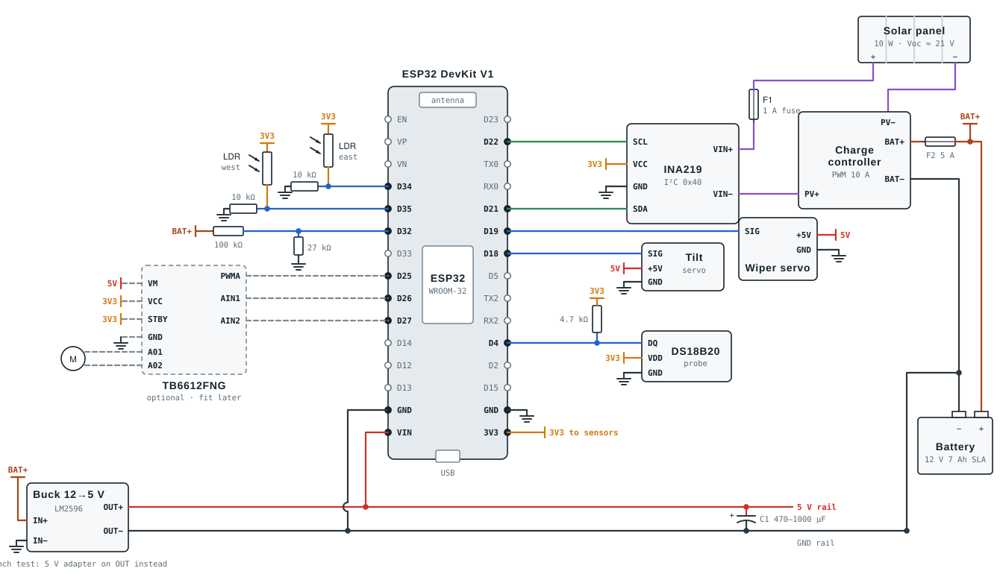

# Wiring



For an interactive version with a tick-off wire list, open [`interactive/wiring-sheet.html`](interactive/wiring-sheet.html) in a browser.

## Power plan

```
Solar panel ─ F1 1 A ─ INA219 ─ PV+  ┌──────────────────┐  BAT+ ─ F2 5 A ─ Battery 12 V 7 Ah
Solar panel − ─────────────── PV−    │ Charge controller │  BAT− ─────────── Battery −
                                     └──────────────────┘
Battery (BAT+, after F2) ─ Buck 12→5 V ─ 5 V rail ─ ESP32 VIN, servos
                                          ESP32 3V3 ─ 3.3 V rail ─ INA219, LDRs, DS18B20, battery divider
```

| Net | Source | Feeds |
|---|---|---|
| **BAT+** | Battery + after fuse F2 | Charge controller BAT+, buck converter IN+, battery divider |
| **5 V** | Buck converter output, set to 5.1 V | ESP32 VIN, both servos, optional motor driver |
| **3.3 V** | ESP32 3V3 pin | INA219, LDR dividers, DS18B20 |
| **GND** | Battery − | Everything except panel − |
| **Panel** | Panel → F1 → INA219 → controller PV+ / PV− | The charge controller only |

**Why the buck is fed straight from the battery, not from the controller's LOAD terminals:** many cheap PWM controllers switch the *negative* side of the load output. Feeding the buck from the battery keeps one solid ground for the ESP32, whatever controller you buy. The firmware replaces the controller's low-voltage cut-off. Below 11.8 V it deep-sleeps and only resumes above 12.3 V. Leave the LOAD terminals empty.

**Bench testing without a battery:** connect a 5 V 2–3 A adapter to the 5 V and GND rails instead of the buck output (never both), and set `BATTERY_ENABLED = false` in `config.h`.

## ESP32 pin map

| ESP32 pin | Connects to | Notes |
|---|---|---|
| VIN | 5 V rail | Unplug while uploading over USB unless your board has a USB protection diode |
| GND | GND rail | Either GND pin |
| 3V3 | 3.3 V rail | Sensors only, never servos |
| GPIO 4 | DS18B20 data | 4.7 kΩ pull-up to 3.3 V |
| GPIO 18 | Tilt servo signal | 50 Hz PWM |
| GPIO 19 | Wiper servo signal | |
| GPIO 21 | INA219 SDA | |
| GPIO 22 | INA219 SCL | |
| GPIO 32 | Battery divider (100 kΩ / 27 kΩ) | ADC1. 14.4 V on the battery = 3.06 V at the pin |
| GPIO 34 | East LDR divider | ADC1 (keeps working with Wi-Fi on) |
| GPIO 35 | West LDR divider | ADC1 |
| GPIO 25 / 26 / 27 | Motor driver PWMA / AIN1 / AIN2 | Optional |

Avoid GPIO 6–11 (flash) and GPIO 0, 2, 5, 12, 15 (boot strapping pins). Don't put analog sensors on ADC2 pins (GPIO 0, 2, 4, 12–15, 25–27); ADC2 stops working once Wi-Fi starts.

## Wire list

Wire in this order. Numbers match the [bring-up guide](bring-up.md).

### Battery and power (battery to controller before the panel)
| # | From | To | Notes |
|---|---|---|---|
| 1 | Battery + | Fuse F2 (5 A) | Inline fuse within 15 cm of the battery terminal |
| 2 | Fuse F2 | Controller BAT+ | This fused positive is the BAT+ net |
| 3 | Battery − | Controller BAT− | |
| 4 | BAT+ (after F2) | Buck IN+ | |
| 5 | Battery − | Buck IN− | On an LM2596, IN− and OUT− are the same ground |
| 6 | Buck OUT+ | 5 V rail | Turn the buck's screw to 5.1 V **before** connecting anything |
| 7 | Buck OUT− | GND rail | |
| 8 | 5 V rail | ESP32 VIN | |
| 9 | GND rail | ESP32 GND | |
| 10 | C1 + / − | 5 V rail / GND rail | 470–1000 µF, ≥10 V. Stripe side is −. Fit near the servo connectors |
| 11 | ESP32 3V3 | 3.3 V rail | |

### INA219
| # | From | To |
|---|---|---|
| 12 | INA219 VCC | 3.3 V rail |
| 13 | INA219 GND | GND rail |
| 14 | INA219 SDA | GPIO 21 |
| 15 | INA219 SCL | GPIO 22 |

### Panel circuit (use 0.5 mm² or thicker wire)
| # | From | To | Notes |
|---|---|---|---|
| 16 | Panel + | Fuse F1 (1 A) | Inline fuse holder |
| 17 | Fuse F1 | INA219 VIN+ | Screw terminal |
| 18 | INA219 VIN− | Controller PV+ | |
| 19 | Panel − | Controller PV− | **Only here.** Never to the GND rail: many controllers switch the negative line, and a ground link bypasses them |

### Battery sense
| # | From | To | Notes |
|---|---|---|---|
| 20 | 100 kΩ resistor | BAT+ → GPIO 32 | |
| 21 | 27 kΩ resistor | GPIO 32 → GND | |
| 22 | 0.1 µF capacitor | GPIO 32 → GND | Smooths the reading |

### LDR pair
| # | From | To | Notes |
|---|---|---|---|
| 23 | East LDR, leg 1 | 3.3 V rail | |
| 24 | East LDR, leg 2 | GPIO 34 | Junction with the 10 kΩ |
| 25 | 10 kΩ resistor | GPIO 34 → GND | Optional 0.1 µF from GPIO 34 to GND |
| 26 | West LDR, leg 1 | 3.3 V rail | |
| 27 | West LDR, leg 2 | GPIO 35 | Junction with the 10 kΩ |
| 28 | 10 kΩ resistor | GPIO 35 → GND | |

Mount the two LDRs side by side with a black divider wall between them, about 3 cm tall, running north–south. When the sun is off to one side the wall shades one LDR.

### DS18B20
| # | From | To | Notes |
|---|---|---|---|
| 29 | Red (VDD) | 3.3 V rail | |
| 30 | Black (GND) | GND rail | |
| 31 | Yellow (DQ) | GPIO 4 | Some probes use white or blue for data |
| 32 | 4.7 kΩ resistor | GPIO 4 → 3.3 V | Pull-up |

Tape the probe to the back of the panel with aluminium tape.

### Servos
| # | From | To |
|---|---|---|
| 33 | Tilt servo brown | GND rail |
| 34 | Tilt servo red | 5 V rail |
| 35 | Tilt servo orange | GPIO 18 |
| 36 | Wiper servo brown | GND rail |
| 37 | Wiper servo red | 5 V rail |
| 38 | Wiper servo orange | GPIO 19 |

### Optional motor driver (TB6612FNG)
| # | From | To |
|---|---|---|
| 39 | VM | 5 V rail |
| 40 | VCC | 3.3 V rail |
| 41 | GND | GND rail |
| 42 | STBY | 3.3 V rail |
| 43 | PWMA | GPIO 25 |
| 44 | AIN1 | GPIO 26 |
| 45 | AIN2 | GPIO 27 |
| 46 | A01 / A02 | DC motor |

## Energy budget (10 W panel, Bengaluru)

| | Per day |
|---|---|
| Harvest on a sunny day, after PWM and battery losses | ≈ 30–40 Wh |
| Use while awake (ESP32 + Wi-Fi + servo moves ≈ 1 W × 12 h) | ≈ 12 Wh |
| Use asleep at night (≈ 0.12 W × 12 h) | ≈ 1.5 Wh |
| Battery (12 V × 7 Ah) | ≈ 84 Wh, of which ~50 % is usable for a long lead-acid life |

That leaves a healthy surplus on sunny days and 2–3 days of reserve. With `NIGHT_DEEP_SLEEP = false` the night use rises to ~12 Wh, and a 5 W panel would not keep up.

## Common problems

| Symptom | Likely cause |
|---|---|
| Battery reads 0 V on the dashboard | Divider not connected to GPIO 32 (wires 20–21) |
| Battery reading differs from a multimeter | Set `BATTERY_CAL` in `config.h` (see bring-up step 4) |
| Controller's charging light never comes on | Battery connected after the panel, or PV wires swapped |
| `NO_CHARGE` in full sun | Wire 18 or 19 loose, or controller fault |
| ESP32 resets when a servo moves | Missing C1, or buck converter rated under 2 A |
| LDRs read 4095 in sun | Divider resistor too large. Try 4.7 kΩ or 2.2 kΩ |
| DS18B20 reads −127 | Missing 4.7 kΩ pull-up or wrong data wire |
| Panel turns away from the sun | Set `TILT_INVERT = true` in `config.h` |
| Dashboard offline at night | Normal with `NIGHT_DEEP_SLEEP = true` |
